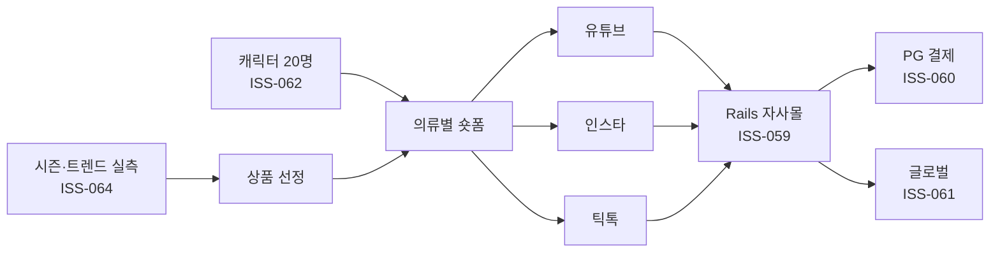

# JIEUN PRD v2

- 작성일: 2026-10-15 (이슈 ISS-027)
- 대체 대상: v1 (2026-09 이전, 익명 CRM·재고관리 중심, `../legacy_docs/EPIC_STORY.md`)
- 근거 자료: `docs/plan/commerce-pivot.md`, `docs/plan/fable-review-2026-10-13.md`, `docs/plan/sheet-to-content-pipeline.md`, `.claude/issue-db/registry.json`, 대표님 결정 메모(2026-10-13, 2026-10-15), 코드(`app/models`, `config/routes.rb`, `db/schema.rb`)
- 원칙: 자료에 없는 수치·날짜는 쓰지 않는다. 모르는 값은 "미정"으로 둔다.

---

## 1. 한 줄 정의와 사업 구조

**JIEUN 은 유튜브·인스타·틱톡에 의류별 숏폼 영상을 올리고, 시청자를 Rails 로 직접 구축한 자사 온라인 쇼핑몰로 유인해 매출을 만드는 B2C 이커머스다.**

- "패션 운영 OS"(B2B)가 아니다. 저장소 이름 `musinsa_clone` 의 "무신사"는 벤치마킹 표현이며, 무신사 입점은 판매 경로가 아니다. 쇼핑몰에는 최신 의류 쇼핑몰 개념을 더한다. (대표님 확정 2026-10-13)
- 영상 속 주인공은 **연령별 AI 캐릭터**다. 20~50대 각 연령대 5명(4개 연령대 x 5 = 20명) 로스터가 확정되었고(정본 `persona/ROSTER.md`), 첫 캐릭터는 강유나(32세)다.
- **계절별·트렌드별 의류 선택을 Claude 가 돕는 것이 상시 역할**이다.
- 결제는 **PG 연결 예정**이다. 이 쇼핑몰은 전역 "PG 없이 계좌 수금" 규칙의 예외다. 글로벌 판매(다국어·다통화·해외 결제/배송)를 대비한다.

### 상품 입수 -> 콘텐츠 흐름 (ISS-081, 대표님 확정 2026-10-15)
공급사·MD 가 공유 구글시트에 상품을 한 줄씩 입력하면, 대표님 맥의 로컬 워커가 시트를 읽어 이미지 품질 판정 -> 모델 3명 추천 -> 컷 이미지·영상 로컬 생성 -> 배포 서버 업로드 -> 시트에 상태·링크 회신을 수행한다. 배포 서버는 파일 저장, 상품·캐릭터 연결, 자사몰 노출, 1명 선택 화면을 맡는다. 생성 AI 는 맥에서 직접 돌지 않고 외부 생성 서비스를 호출한다. 상세는 `docs/plan/sheet-to-content-pipeline.md`.

---

## 2. 사용자와 역할

| 역할 | 하는 일 | 사용하는 화면·수단 |
|---|---|---|
| 대표님 | 사업 결정(정책·PG·서버·예산), 추천 모델 3명 중 1명 선택, 승인 | 관리자 로그인 화면, 이슈 관제 |
| MD | 상품 선정·소구포인트 입력, 이미지 판정 "보완" 건의 진행/재요청 결정 | 공유 구글시트(`MD확인` 칸), 상품분석·KPI 화면 |
| 공급사 | 판매 가능 상품과 이미지를 엑셀 또는 시트로 제공, 발주서 확인 | 엑셀 가져오기(`supplier_imports`), 시트 행, 발주 확인 URL(토큰) |
| 고객 | 영상을 보고 자사몰에서 상품 탐색·주문·결제 | 자사몰 프론트(현재 범위 한정, 3절 참조) |

- 고객 계정·비회원 주문은 아직 없다(3절). 역할별 권한 체계는 현재 관리자 인증(ISS-012) 한 종류뿐이다. MD·공급사 별도 권한은 자료에 없다 -> 미정.

---

## 3. 현재 구현됨 vs 미구현

기준일 2026-10-15. 근거는 `config/routes.rb`, `app/models`, `app/services`, `app/jobs`, `db/schema.rb`, registry 상태.

### 3.1 구현됨

| 영역 | 내용 | 코드 근거 | registry |
|---|---|---|---|
| 상품 관리 | 상품 CRUD, 옵션(Variant), 단일 대표 이미지, AI 속성(Hash) | `resources :products`, `Product`, `Variant`, `has_one_attached :image` | ISS-004, 008, 022 완료 |
| 재고 입출고 | 바코드 스캔(html5-qrcode), 입고·출고·이력, 재고 조정 일원화 | `namespace :inventory`, `Inventory::StockAdjuster`, `BarcodeScanner`, `StockLog` | ISS-006, 031~040 완료 |
| 발주·거래처 | 거래처 CRUD, 발주 제출·입고, 토큰 확인 URL(1회성·만료) | `resources :suppliers`, `purchase_orders`, `po/confirm/:token` | ISS-009~011 완료 |
| 공급사 엑셀 가져오기 | 엑셀(이미지 포함) 상품 가져오기 | `supplier_imports`, `SupplierImports::Importer`, `XlsxParser` | ISS-077 DONE |
| 상품분석·KPI | 상품에 캐릭터·컨셉 배정, 목표 vs 실적 매출 KPI | `product_analyses`, `Character`, `get "kpi"`, `Kpi::Calculator`, `ProductAnalyses::Analyzer` | ISS-077 DONE |
| 관리자 인증 | 로그인·로그아웃, 백오피스 보호 | `sessions`, `User` | ISS-012 완료 |
| 익명 CRM(v1 유산) | 취향 분석, 지역 트렌드 대시보드 | `namespace :dashboard`, `AnonyCustomer`, `Crm::PreferenceAnalyzer` | ISS-016 완료, ISS-017 READY |
| ClaudeBot | Claude API 메시지 생성(출처 컬럼, x-api-key) | `ClaudeBot::MessageGenerator` | ISS-014 완료 |
| UCP API | 외부 에이전트용 상품 조회 | `GET /api/v1/ucp/products` | ISS-025, 051 완료 |
| 스냅·검색·리뷰 | 스타일 피드, 검색, 리뷰 작성 | `snaps`, `search`, `reviews#create` | ISS-020, 021 완료 |
| 시트 연동 골격 | 구글시트 폴링·시트 레이아웃·gws 클라이언트 | `app/services/sheet_pipeline/{poller,gws_client,sheet_layout}.rb` | ISS-083 IN_PROGRESS (완성 아님) |
| 이미지 가공 골격 | `image_processings` 모델(kind: cutout/try_on), job | `ImageProcessing`, `ImageProcessingJob` | ISS-042 IN_PROGRESS (완성 아님) |
| 운영 기반 | CI 진실화, Rack::Attack, Health check, PWA | `up`, `manifest`, `service-worker` | ISS-003, 005 완료 |

### 3.2 미구현

| 영역 | 상태 | 근거 | 이슈 |
|---|---|---|---|
| 고객 계정·비회원 주문 | 없음. `User` 는 관리자 로그인용 | cart/checkout 라우트 없음, `commerce-pivot.md` | ISS-059 READY |
| 장바구니·주문서·배송지·주문 상태 | 없음. 배송지는 어디에도 저장하지 않는 설계 | `schema.rb` 주소는 `suppliers` 에만 존재 | ISS-059, ISS-058(정책 선행) |
| 결제 | 없음 | 결제 라우트·모델 없음 | ISS-060 BLOCKED |
| 다국어·다통화 | 화면 문구 한국어 하드코딩, `price` 단일 decimal | `config/locales`, `schema.rb` (`commerce-pivot.md` 실측) | ISS-061 READY |
| 캐릭터 로스터 20명 시트 | 시트 생성 미착수(이름·초안만 확정) | `Character` 모델은 있으나 로스터 데이터는 별도 | ISS-062 READY |
| 영상 상품상세 | 없음 | 첫 화면 런웨이 영상·착용 사이즈 표기·AI 가상인물 표기 | ISS-063 READY |
| 시즌·트렌드 상품 선정 파이프라인 | 없음 | 데이터랩 쇼핑인사이트 등 주간 실측 | ISS-064 READY |
| 누끼·착용컷 생성 | 골격만. 어댑터·편집 UI 없음 | `ImageProcessing` 모델만 존재 | ISS-041~047 |
| 이미지 품질 판정·모델 추천·컷/영상 자동화 | 설계만 완료(ISS-081, 082 DONE), 구현 대기 | `docs/plan/sheet-to-content-pipeline.md` | ISS-084, 085 READY, ISS-086, 087 BACKLOG |
| 유입원 추적 | 없음 | 주문에 캐릭터·플랫폼·영상 저장 장치 없음 | ISS-070 BACKLOG |
| 배포 | `config/deploy.yml` 서버가 자리표시값 | `fable-review` 9번 | ISS-024 BLOCKED |
| 캠페인 발송 | 재정의 필요 | | ISS-013 READY |
| 주문 수집·주소 폐기 | v1 방향이 10-13 결정과 충돌 | | ISS-015 BLOCKED |

---

## 4. 범위

### 4.1 v2 범위 안

1. **자사몰 커머스 코어**: 비회원 주문서, 배송지, 주문 상태(고객 계정은 2차). ISS-059
2. **결제**: PG 연동 어댑터, 결제 실패·취소·환불 경로. ISS-060 (PG 선정 후)
3. **캐릭터**: 로스터 20명 설계·시트·체형 수치(ISS-062), 강유나 1호 확정(ISS-072), 캐릭터 옷장·영상 상품상세(ISS-063)
4. **콘텐츠 파이프라인**: 시트 연동 워커(ISS-083), 이미지 품질 게이트(ISS-084), 모델 3명 추천(ISS-085), 컷·영상 생성과 업로드(ISS-086, 087), 영상 제작 파이프라인(ISS-074)
5. **상품 입수·분석**: 공급사 엑셀/시트 가져오기, 상품분석, KPI 운영(ISS-077 완료분 유지·확장)
6. **상품 선정 지원**: 시즌·트렌드 실측 기반 캐릭터별 추천. ISS-064
7. **이미지 가공(공급사 사진 보정)**: 누끼 파이프라인과 착용컷의 관리자용 기능. ISS-041~047
8. **글로벌 대비**: i18n(ko/en 우선), 다통화 표기, 해외 배송비·관세 고지. ISS-061 (국내 첫 매출 뒤)
9. **판매 선행 조건**: 개인정보 정책(ISS-058), 판매 법적 요건(ISS-071), 유입원 추적(ISS-070), 1차 판매 상품 확정(ISS-068), 영상 생성 경로 결정(ISS-069), 배포(ISS-024)
10. **기존 백오피스 유지**: 재고·바코드·발주·거래처는 사입 운영에 그대로 사용(신규 개발 없음)

### 4.2 범위 밖 / 차기

- **결정(ISS-048): 소비자 셀프 피팅(고객이 자신의 사진으로 입어보는 기능)은 v2 범위 밖이며 차기로 미룬다.** v2 의 착용컷(ISS-046, 047)은 관리자가 고정 아바타로 만드는 상품 이미지 용도이며, 소비자 업로드 기능이 아니다.
- 무신사 등 외부 마켓 입점·주문 자동 수집(ISS-015, ISS-030 외부채널 수집 스파이크): 판매 경로가 아니므로 v2 핵심에서 제외, 스파이크로만 보존.
- UCP·데이터 리포트 판매 메시지: 주력에서 제외(홍보 기준은 "콘텐츠 -> 채널 -> 자사몰 전환" 퍼널).
- 채팅형 분석(ISS-029, 보류), 상세 재고이력 탭(ISS-018, P3).
- 상품 카탈로그 피드(인스타 쇼핑태그·유튜브 쇼핑 공통): "나중"(ISS-076, P3).
- 고객 계정(회원) 기능 확장: 1차는 비회원 주문, 계정은 2차(fable-review 제안).
- 20명 캐릭터 전원 운영: 시트는 20명 생성하되, 영상·계정·상품 배정 운영 범위는 미정(5절 D-05).

---

## 5. 미결정 사항 (대표님 결정 필요)

| ID | 사안 | 이슈 | 상태 | 막고 있는 것 |
|---|---|---|---|---|
| D-01 | 개인정보 배송지 보관 정책: 익명 CRM(주소 미보관) vs 자사몰·해외 배송지 저장. 보관기간·파기 시점. 주문기록(법정 보존)과 배송지(파기)의 분리 여부 | ISS-058 | BLOCKED | ISS-015, ISS-059 착수 |
| D-02 | PG 선정: 국내 카드 + 해외 카드 지원 PG | ISS-060 | BLOCKED | 결제 연동 |
| D-03 | 배포 서버 주소·도메인·kamal secrets (`config/deploy.yml` 이 자리표시값) | ISS-024 | BLOCKED | 배포, 시트 파이프라인의 서버 업로드 |
| D-04 | 첫 매출을 계좌이체로 먼저 열 것인가, PG 완료까지 기다릴 것인가 (fable 추천: 계좌이체 선개시. 대표님 결정 'PG 연결 예정'과 순서만 다름) | (이슈 미등록) | 미결정 | 최단 매출 경로 |
| D-05 | 1차 론칭 캐릭터 범위: 강유나 1명 / 30대 5명 / 20명 전원 | ISS-062, 072 | 미결정 | 영상·계정 운영 범위 |
| D-06 | 영상 생성 경로와 월 예산: 2026-10-29 Higgsfield 소멸 이후(재구독 / API / 소멸 전 몰아서 생성). 시트 파이프라인 문서에는 구독 2026-10-29 종료로 기록 | ISS-069 | BACKLOG | 영상 생산, ISS-074, 086, 087 |
| D-07 | 1차 판매 상품 확정·사입: 상품명·색상·가격·소재·사이즈·재고·실사진·마진 | ISS-068 | BACKLOG | 영상·상세·추천 전반 |
| D-08 | SNS 계정 구조: 브랜드 1계정 vs 캐릭터별 계정, 핸들 중복 확인 | ISS-073 | BACKLOG | 유입 경로 설계 |
| D-09 | 판매 법적 요건: 통신판매업 신고, 약관·개인정보처리방침, 청약철회·반품, 거래기록 법정 보존 항목·기간(법령 원문 확인 필요) | ISS-071 | BACKLOG | ISS-058, 060 입력 |
| D-10 | 누끼 공급사 선정: 실제 사입 사진 10장으로 fal BiRefNet vs Photoroom 비교(외부 과금 필요) | ISS-041 | BLOCKED | ISS-043 이후 누끼 기능 |
| D-11 | 공유 구글시트를 새로 만들지, 기존 시트를 쓸지 | ISS-083 (선결 조건) | 미결정 | 시트 연동 |
| D-12 | 외국인 캐릭터 배치 여부(글로벌 판매 시) | ISS-062 | 미결정 | 로스터 확정 |

참고: 현재 이슈 ISS-058, 060, 024, 041 은 registry 에서 BLOCKED 이며 사유는 위 표와 같다. D-04~D-08, D-11, D-12 의 "상태"는 자료상 결정 기록이 없다는 뜻이다.

---

## 6. 성공 지표

자료에 수치 목표가 있는 항목만 적는다. 나머지는 미정이다.

| 지표 | 목표 | 근거 |
|---|---|---|
| 캐릭터·컨셉별 목표 매출 vs 실적 매출 | 운영 항목으로 존재(`/kpi`). 목표 금액은 미정 | ISS-077, 대표님 지시 2026-10-13 |
| 영상 1편 원가 | 상품 마진의 10% 이내(운영 원칙, `labang-video`) | `fable-review` 5번 |
| 이미지 품질 판정 기준 | 짧은 변 800px 이상·JPEG 품질 85 이상·선명도 300 이상이면 통과(임시 기준, 공급사 실제 이미지 20장 확보 후 재설정) | `sheet-to-content-pipeline.md` |
| 월 매출 / 전환율 / 유입 / 방문자 | 미정 | 자료 없음 |
| 유입원별(캐릭터·플랫폼·영상) 주문 집계 | 주문 1건에 유입원 기록 + 대시보드 집계 (수치 목표는 미정) | ISS-070 |
| 공급사별 이미지 반려율 | 서버에 판정 저장해 모니터링 (목표치는 미정) | `sheet-to-content-pipeline.md` |
| 이미지 가공 월 호출 상한 | ENV 로 설정(값은 미정) | ISS-042 완료 조건 |

---

## 7. 변경 이력

| 일자 | 버전 | 내용 | 근거 |
|---|---|---|---|
| 2026-01-31 | v1 | 익명 CRM·재고관리 중심 에픽(Epic 1~9) | `../legacy_docs/EPIC_STORY.md` |
| 2026-10-13 | (결정) | 숏폼 -> 자사몰 B2C, Rails 직접 구축, PG 연결 예정, 20~50대 x 5 캐릭터, 글로벌 판매 대비 | 대표님 결정, ISS-058~064 |
| 2026-10-15 | (결정) | 구글시트 공유 + 로컬 생성 + 배포 서버 업로드 구조 | 대표님 확정, ISS-081 |
| 2026-10-15 | v2 | 위 결정들을 묶어 PRD v2 로 재작성. ISS-048 셀프 피팅 범위 밖 결정 명기 | ISS-027, ISS-048 |
