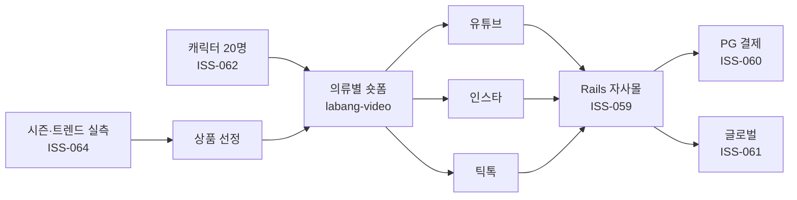

# JIEUN 커머스 전환 계획

> 대표님 결정 2026-10-13. 이슈 ISS-058~064.

## 사업 구조

## 현재 Rails 앱 갭 (2026-10-13 코드 실측)
| 필요 | 현재 | 근거 |
|---|---|---|
| 고객 계정·장바구니·주문서 | 없음 (`User`는 관리자 로그인용, cart/checkout 라우트 없음) | `config/routes.rb`, `app/models` |
| 결제 | 없음 | — |
| 배송지 | 없음 — 익명 CRM이 주소를 보관하지 않는 설계 | `db/schema.rb` (주소는 `suppliers`에만) |
| 다국어 | `en.yml`만, 화면 문구는 한국어 하드코딩 | `config/locales` |
| 다통화 | `price` 단일 decimal | `db/schema.rb` |
| 선행 결함 | 해소(ISS-052 `ba5474f`, 테스트 ISS-066 181 runs / 0 failures) — 남은 선행: 배포 ISS-024 | `CLAUDE.md` 알려진 결함 |

## 결정이 필요한 충돌
- **ISS-058:** 자사몰·해외 배송에는 전체 주소가 필요하다. "주소는 지운다"를 유지하려면 "배송 완료 후 N일 뒤 파기"로 재정의해야 한다. 해외 배송은 수취인 정보 보관 요건을 따로 확인해야 한다(미확인).

## 캐릭터 로스터 초안 (20명 = 4개 연령대 × 5)
연령대 안에서 5명은 **스타일 축**으로 나눈다. 같은 연령대 캐릭터끼리 겹치지 않게 하고, 의류 카테고리를 나눠 맡는다.

| 스타일 축 | 맡는 의류 | 20대 | 30대 | 40대 | 50대 |
|---|---|---|---|---|---|
| 미니멀·오피스 | 셔츠·슬랙스·코트 | 서하린 | 한소율 | 문서진 | 정혜원 |
| 캐주얼·데일리 | 니트·데님·패딩 | 타나카 미오 | **강유나** | 배연희 | 남궁선 |
| 스트리트·스포티 | 후디·트랙·애슬레저 | 제이드 박 | 마야 첸 | 줄리아 페리 | 노라 휫필드 |
| 페미닌·로맨틱 | 원피스·블라우스·스커트 | 윤채이 | 오다은 | 권미래 | 이정란 |
| 트렌드·하이패션 | 시즌 키 아이템 | 레아 모로 | 에린 소 | 모리 아야 | 사라 린드 |

상세(나이·출생·성격): `../persona/ROSTER.md` (2026-10-13, 강유나 외 19명은 대표님 위임으로 작명)

- 글로벌 판매를 생각하면 일부 칸은 외국인 캐릭터로 둘 수 있다 — 대표님 결정.
- 캐릭터마다 키·사이즈를 정한다 → 상품상세 "유나 163cm·55 / M 착용" 표기에 쓴다.
- 비용 실측 기준: 시트 9장 약 $0.5 + 기준사진 2~4크레딧 → 20명 약 $10 + 80크레딧 안팎.

## 실행 순서 (제안)
1. (완료) ISS-052 부팅 결함 해소(`ba5474f`) + 테스트 복구(ISS-066 181 runs / 0 failures) — 남은 선행: 배포 ISS-024
2. ISS-058 개인정보 정책 결정 → ISS-059 커머스 코어
3. ISS-062 캐릭터 로스터 (커머스와 병렬 가능)
4. ISS-060 PG (선정 후) → ISS-061 글로벌 → ISS-063 영상 상품상세
5. ISS-064 트렌드 파이프라인 (상시)
