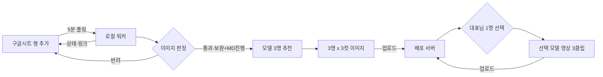

# 구글시트 → 모델 추천 → 컷·영상 → 배포 (ISS-081)

> 2026-10-15 대표님 확정: "구글시트를 공유해서 하는 작업이니까 로컬에서 이미지, 영상 만들어서 배포 서버로 올리는 것으로 하자."

## 역할 분담
| 위치 | 하는 일 |
|---|---|
| 구글시트(공유) | 공급사·MD가 상품 한 줄씩 입력, 진행 상태·결과 링크 확인 |
| 로컬 워커(대표님 맥) | 시트 읽기(`gws`, 대표님 구글 계정) → Claude 추천 3명 → 컷 이미지·영상 생성(Higgsfield CLI·ffmpeg) → 서버 업로드 → 시트에 상태·링크 기록 |
| 배포 서버(Rails) | 받은 이미지·영상 저장(Active Storage), 상품·캐릭터 연결, 자사몰 노출, 1명 선택 화면 |

생성 AI는 맥에서 직접 돌지 않는다(M2 16GB로 영상 모델 불가). 로컬 워커가 외부 생성 서비스를 호출하고 결과 파일을 맥에 받은 뒤 검수·합성해서 올린다.

## 흐름

## 시트 양식(안)
| 칸 | 내용 | 작성 |
|---|---|---|
| 상품코드 | 공급사 코드 | 입력 |
| 상품명 | | 입력 |
| 이미지 | 드라이브 링크 또는 URL(여러 장은 줄바꿈) | 입력 |
| 소구포인트 1~3 | 칸당 한 줄 | 입력 |
| 가격·색상 | 영상 음성에 넣지 않음(오버레이 전용) | 입력 |
| 상태 | 대기 / 추천완료 / 컷완료 / 선택대기 / 영상완료 / 실패:사유 | 워커 |
| 추천 모델 | 1·2·3순위 이름 | 워커 |
| 결과 링크 | 서버 상품 페이지 | 워커 |

## 이미지 품질 게이트 (ISS-082)
> 2026-10-15 대표님: "옷 이미지가 떨어지면 향후 모든 작업에 영향이 잇어. 최소 기준 수치를 정해야 할거야." / "시트내에 이미지에 대한 판정 컬럼을 만들어 운영하자."

입수 직후, 추천·생성보다 먼저 돈다. **반려된 행은 이후 단계(추천·컷·영상)로 넘어가지 않는다** — 나쁜 원본에 크레딧을 쓰지 않는다.

### 1차: 수치 판정 (로컬, 비용 0)
| 항목 | 반려 | 보완 | 통과 | 측정 |
|---|---|---|---|---|
| 짧은 변 | < 512px | 512~799px | ≥ 800px | 픽셀 |
| JPEG 품질 | < 70 | 70~84 | ≥ 85 | 양자화표 추정(`identify %Q`) |
| 선명도(옷 영역 라플라시안 분산, 원본 해상도) | < 100 | 100~299 | ≥ 300 | 배경(밝기 ≥245) 제외 |
| 옷 노출(흰 날림·검은 뭉개짐, 옷 영역) | > 15% | 5~15% | < 5% | 밝기 ≥250 / ≤5 비율 |
| 파일 | 열리지 않음·이미지 아님·링크 권한 없음 | — | 정상 | |

기준 근거(2026-10-15 실측, 실제로 생성에 썼고 결과가 쓸 만했던 원본 2장):
| 원본 | 크기 | 품질 | 선명도(옷 영역) |
|---|---|---|---|
| runway-02 `product.png` (흰 배경 단품) | 534×534 | 92 | 1043 |
| runway-04 `product_coat.jpg` (카멜 코트 착용컷) | 592×1280 | 95 | 597 |
- 두 장 모두 짧은 변이 512~600px이라 800px 기준이면 **보완**에 걸린다. 쓸 만은 했지만 단추·조직 디테일이 생성에서 뭉개졌던 크기라 "통과"가 아니라 "보완(진행 가능)"으로 둔다.
- 같은 이미지를 짧은 변 400px로 줄이면 선명도가 1/5~1/8로 떨어졌다 → 512px 미만은 반려.
- **임시 기준이다.** 공급사 실제 이미지 20장이 모이면 분포를 보고 다시 정한다(이 표를 갱신).

### 2차: 내용 판정 (Claude 비전, 1차 통과·보완만)
| 항목 | 반려 조건 |
|---|---|
| 옷 전체가 보이는가 | 소매·밑단이 잘림 |
| 상품이 하나인가 | 여러 벌이 섞여 어떤 상품인지 모호 |
| 가림 | 워터마크·텍스트·타사 로고가 옷 위에 있음 |
| 형태 | 구겨져 실루엣을 알 수 없음 |
| 색 | 조명 색이 강해 실물 색 판단 불가 → 보완 |
점수 0~100과 사유 한 줄. 2차는 판정만 하고 수치를 지어내지 않는다(확인 불가 → "확인 불가").

### 시트 판정 컬럼
| 칸 | 값 | 작성 |
|---|---|---|
| 이미지판정 | 통과 / 보완 / 반려 | 워커 |
| 판정점수 | 0~100 | 워커 |
| 판정사유 | 가장 나쁜 항목 1~2개 (예: "짧은 변 534px, 800px 이상 필요") | 워커 |
| 수치 | `534px · Q92 · 선명 1043 · 날림 0.2%` | 워커 |
| 판정시각 | | 워커 |
| MD확인 | 비움 / 진행 / 재요청 | 사람 |

운영 규칙:
- **통과** → 자동 진행.
- **보완** → MD확인이 "진행"일 때만 진행. "재요청"이면 공급사에 다시 받는다.
- **반려** → 진행하지 않는다. 이미지를 바꾸면(링크·파일 해시 변경) 자동 재판정.
- 판정 결과는 서버에도 저장해 공급사별 반려율을 본다(이미지 품질이 낮은 공급사 파악).

## 서버 업로드 방식
- 서버에 업로드 전용 API 1개(`POST /api/content_uploads`), 토큰 인증(토큰은 `.env`·kamal secrets에만).
- 같은 파일 재업로드는 sha256으로 중복 방지. 실패는 시트 상태 칸에 `실패:사유`로 남긴다(가짜 성공 금지).

## 선결 조건
1. 배포 서버: `config/deploy.yml`의 서버가 자리표시값(192.168.0.1)이다. 실제 서버 주소·도메인이 필요하다.
2. 공유 시트: 시트를 새로 만들지, 기존 시트를 쓸지. `gws`는 대표님 계정으로 시트 접근 확인됨(2026-10-15).
3. 생성 크레딧: Higgsfield 구독 2026-10-29 종료(잔액 31크레딧). 이후 경로 미정.
4. 워커 상시 실행: 맥이 꺼져 있으면 멈춘다. launchd로 로그인 시 자동 실행.

## 단계
- P0 시트 연동 + 이미지 품질 판정 + 3명 추천(생성 비용 0)
- P1 컷 이미지 + 서버 업로드 API + 1명 선택 화면
- P2 영상(라방 3클립 방식 재사용)
- P3 자사몰 상품 페이지 자동 노출
