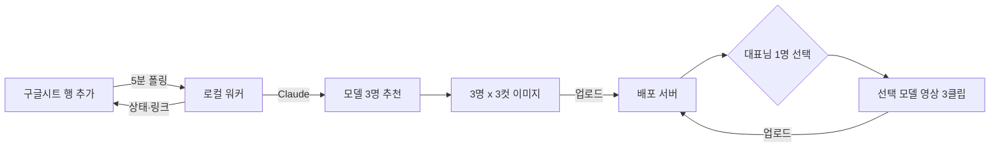

# 구글시트 → 모델 추천 → 컷·영상 → 배포 (ISS-081)

> 2026-10-15 대표님 확정: "구글시트를 공유해서 하는 작업이니까 로컬에서 이미지, 영상 만들어서 배포 서버로 올리는 것으로 하자."

## 역할 분담
| 위치 | 하는 일 |
|---|---|
| 구글시트(공유) | 공급사·MD가 상품 한 줄씩 입력, 진행 상태·결과 링크 확인 |
| 로컬 워커(대표님 맥) | 시트 읽기(`gws`, 대표님 구글 계정) → Claude 추천 3명 → 컷 이미지·영상 생성(Higgsfield CLI·ffmpeg) → 서버 업로드 → 시트에 상태·링크 기록 |
| 배포 서버(Rails) | 받은 이미지·영상 저장(Active Storage), 상품·캐릭터 연결, 자사몰 노출, 1명 선택 화면 |

생성 AI는 맥에서 직접 돌지 않는다(M2 16GB로 영상 모델 불가). 로컬 워커가 외부 생성 서비스를 호출하고 결과 파일을 맥에 받은 뒤 검수·합성해서 올린다.

## 흐름

## 시트 양식(안)
| 칸 | 내용 | 작성 |
|---|---|---|
| 상품코드 | 공급사 코드 | 입력 |
| 상품명 | | 입력 |
| 이미지 | 드라이브 링크 또는 URL(여러 장은 줄바꿈) | 입력 |
| 소구포인트 1~3 | 칸당 한 줄 | 입력 |
| 가격·색상 | 영상 음성에 넣지 않음(오버레이 전용) | 입력 |
| 상태 | 대기 / 추천완료 / 컷완료 / 선택대기 / 영상완료 / 실패:사유 | 워커 |
| 추천 모델 | 1·2·3순위 이름 | 워커 |
| 결과 링크 | 서버 상품 페이지 | 워커 |

## 서버 업로드 방식
- 서버에 업로드 전용 API 1개(`POST /api/content_uploads`), 토큰 인증(토큰은 `.env`·kamal secrets에만).
- 같은 파일 재업로드는 sha256으로 중복 방지. 실패는 시트 상태 칸에 `실패:사유`로 남긴다(가짜 성공 금지).

## 선결 조건
1. 배포 서버: `config/deploy.yml`의 서버가 자리표시값(192.168.0.1)이다. 실제 서버 주소·도메인이 필요하다.
2. 공유 시트: 시트를 새로 만들지, 기존 시트를 쓸지. `gws`는 대표님 계정으로 시트 접근 확인됨(2026-10-15).
3. 생성 크레딧: Higgsfield 구독 2026-10-29 종료(잔액 31크레딧). 이후 경로 미정.
4. 워커 상시 실행: 맥이 꺼져 있으면 멈춘다. launchd로 로그인 시 자동 실행.

## 단계
- P0 시트 연동 + 3명 추천(생성 비용 0)
- P1 컷 이미지 + 서버 업로드 API + 1명 선택 화면
- P2 영상(라방 3클립 방식 재사용)
- P3 자사몰 상품 페이지 자동 노출
